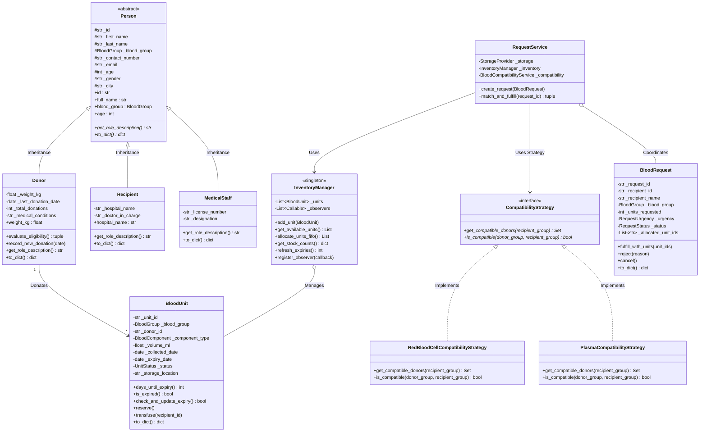
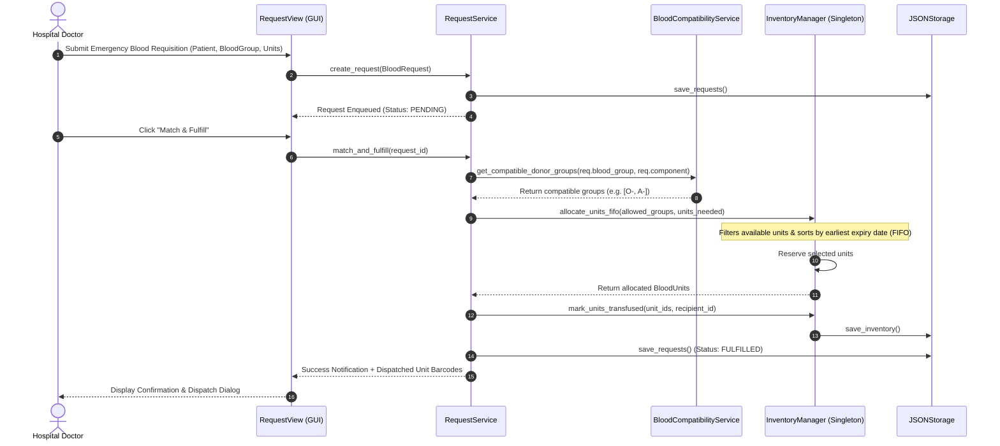
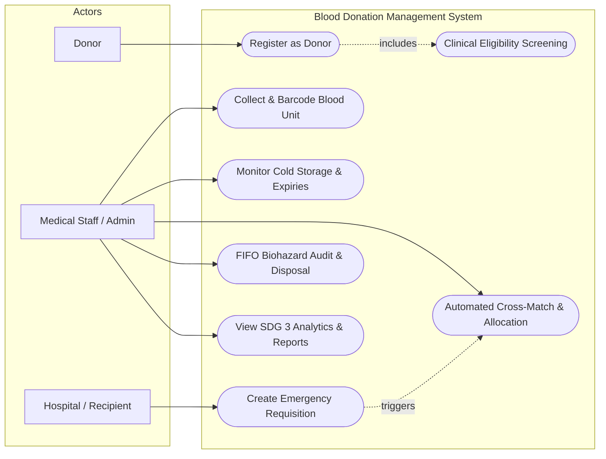

# System Architecture & UML Diagrams

This document contains visual Object-Oriented representations of the Blood Donation Management System (BDMS) using Mermaid UML specifications.

---

## 1. Class Diagram (Object-Oriented Structure)

---

## 2. Sequence Diagram (Emergency Blood Requisition & FIFO Matching)

---

## 3. Use Case Diagram

